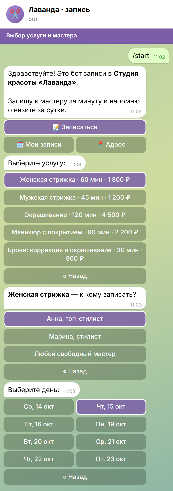
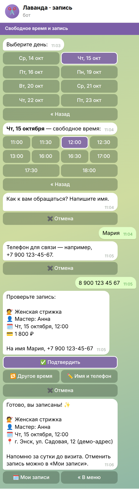
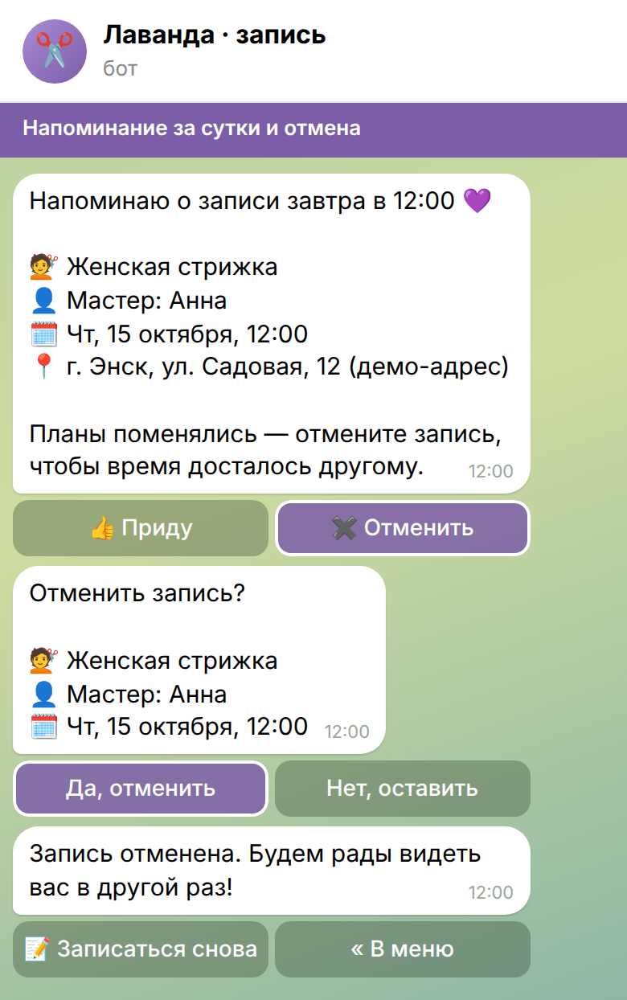

# Бот записи клиентов для Telegram и MAX

Бот для салона, барбершопа, студии или частного мастера: клиент сам выбирает
услугу, мастера и свободное время, оставляет имя и телефон — запись готова.
За сутки до визита бот напоминает, отменить запись можно в два нажатия.
Владелец получает уведомления о записях и отменах и выгружает все записи
в Excel одной кнопкой.

Один и тот же бот работает в **Telegram** и в **MAX**: логика общая, записи
лежат в одной базе, поэтому занятое время видно в обоих мессенджерах сразу.

> Это демо: салон «Лаванда», мастера, клиенты и телефоны выдуманы.

## Как выглядит

| Выбор услуги и мастера | Свободное время и запись | Напоминание и отмена |
|---|---|---|
|  |  |  |

Владелец: уведомления и выгрузка — [снимок](docs/screens/4-vladelets.png),
[таблица](docs/screens/5-tablitsa.png).

Снимки собраны из настоящих ответов бота: тот же код, что работает в
мессенджере, прогнан по сценарию, его сообщения и кнопки нарисованы в рамке
чата (`tools/render_chat.py`).

## Что умеет

**Клиенту**
- выбор услуги (с длительностью и ценой) и мастера — конкретного или «любого свободного»
  (если услугу делают несколько мастеров);
- только реально свободные окна: учитываются график мастера, длительность услуги,
  уже занятое время; записаться можно не позже чем за час до визита
  (`min_lead_min` в каталоге) и не дальше горизонта записи (`booking_days`);
- имя и телефон спрашиваются один раз, дальше бот их помнит; телефон проверяется
  (российский номер, приводится к виду +7 900 123-45-67);
- экран проверки перед подтверждением — можно сменить время или контакты;
- напоминание за сутки с кнопками «Приду» и «Отменить»; если запись сделана
  меньше чем за сутки до визита, напоминания нет — клиент только что получил подтверждение;
- «Мои записи» — список будущих визитов и отмена;
- команды: `/start` — меню, `/book` — записаться, `/my` — мои записи.

**Владельцу**
- уведомление о каждой новой записи и отмене — в Telegram или MAX;
- выгрузка всех записей, включая отменённые, в Excel (№, дата, время, услуга,
  мастер, клиент, телефон, цена, мессенджер, статус, когда создана) — кнопка
  в меню или команда `/export`;
- копия записей в Google Таблице — обновляется сама после каждой записи
  и отмены (если указаны таблица и ключ); лист «Записи» бот создаёт сам и каждый
  раз перезаписывает целиком, поэтому правки руками на этом листе пропадут;
- записи на сегодня — кнопка или `/today`;
- услуги, цены, мастера и их график — в одном файле `data/catalog.json`,
  без правки кода.

**Надёжность**
- два клиента не займут одно время: проверка и запись идут одной транзакцией;
- старые кнопки в истории чата не ломают диалог;
- имена клиентов экранируются, ключи только в `.env`.

## Как запустить

Нужен Python 3.11+.

```bash
python -m venv .venv
.venv/bin/pip install -r requirements.txt
cp .env.example .env        # вписать токены и свой id владельца
.venv/bin/python -m booking
```

- `TG_BOT_TOKEN` — токен бота от [@BotFather](https://t.me/BotFather).
- `MAX_BOT_TOKEN` — токен бота MAX из кабинета платформы для партнёров
  ([business.max.ru](https://business.max.ru)).
- `ADMINS` — кто владелец: `tg:<ваш id в Telegram>`, `max:<id в MAX>`, через запятую.
- `GSHEET_ID`, `GOOGLE_CREDENTIALS` — необязательно, Google Таблица: создать
  сервисный аккаунт в Google Cloud, скачать его ключ JSON и указать путь,
  расшарить таблицу на почту аккаунта с правом редактирования, id из адреса
  таблицы. Нужны обе переменные, иначе копия в Google выключена. Google
  недоступен — запись всё равно проходит, сбой пишется в журнал.
- `DB_PATH`, `CATALOG_PATH` — необязательно, другие пути к базе и каталогу.

Задан только один токен — запустится один мессенджер; нет ни одного — бот
не запустится. Уведомления владельцу приходят только в запущенный мессенджер.
База SQLite создаётся сама в `data/booking.db`.

Свой салон: поправьте `data/catalog.json` — название, адрес, часовой пояс,
шаг сетки (`slot_step_min`), на сколько дней вперёд открыта запись
(`booking_days`), за сколько минут до визита закрывается запись (`min_lead_min`),
услуги и мастеров с рабочими днями (1 — понедельник,
7 — воскресенье) и часами. Ошибку в каталоге — мастер с несуществующей
услугой, конец дня раньше начала, день недели вне 1–7 — бот покажет при запуске.

## Как устроено

```
booking/
  flow.py      диалог записи — общий для обоих мессенджеров
  slots.py     расчёт свободных окон
  db.py        SQLite: клиенты и записи
  catalog.py   чтение и проверка data/catalog.json
  config.py    настройки из .env
  texts.py     даты, цены, телефоны в сообщениях
  export.py    выгрузка в Excel
  gsheet.py    копия записей в Google Таблице
  tg.py        Telegram (aiogram 3)
  maxbot.py    MAX (maxapi)
  __main__.py  запуск обоих ботов и напоминаний
data/catalog.json  услуги, мастера, график
tests/             сценарии записи, отмены, напоминаний, выгрузки, оба адаптера,
                   каталог, настройки, защита от подделанных кнопок и ввода
tools/             сборка снимков диалога для README
```

Ядро получает от мессенджера текст или нажатую кнопку и возвращает ответ —
текст, кнопки, файл. Адаптер Telegram или MAX только переводит это в вызовы
своей библиотеки, поэтому добавить третий канал (ВКонтакте, сайт) — это один
небольшой файл.

## Проверки

- **Telegram** — сценарий записи, отмены, напоминаний и выгрузки прогнан
  через настоящий диспетчер aiogram на тестах; живой прогон в мессенджере — следующий шаг.
- **MAX** — тот же сценарий, проверен на тестах без подключения.
- **Google Таблица** — обновление после записи и отмены и работа при
  недоступном Google проверены на тестах без подключения.

```bash
.venv/bin/pip install -r requirements-dev.txt
.venv/bin/pytest
.venv/bin/ruff check .
```

Пересобрать снимки: `.venv/bin/python tools/render_chat.py` (HTML в `build/screens/`),
затем `.venv/bin/python tools/shoot.py` — PNG в `docs/screens/`. Для второго шага
нужен Playwright с Chromium, его нет в `requirements-dev.txt`:
`.venv/bin/pip install playwright && .venv/bin/playwright install chromium`.

## Что можно добавить под заказ

Оплата предоплаты, синхронизация с Google
Календарём мастеров, напоминание за 2 часа, отзыв после визита, рассылка
по базе клиентов, мини-приложение с расписанием.
